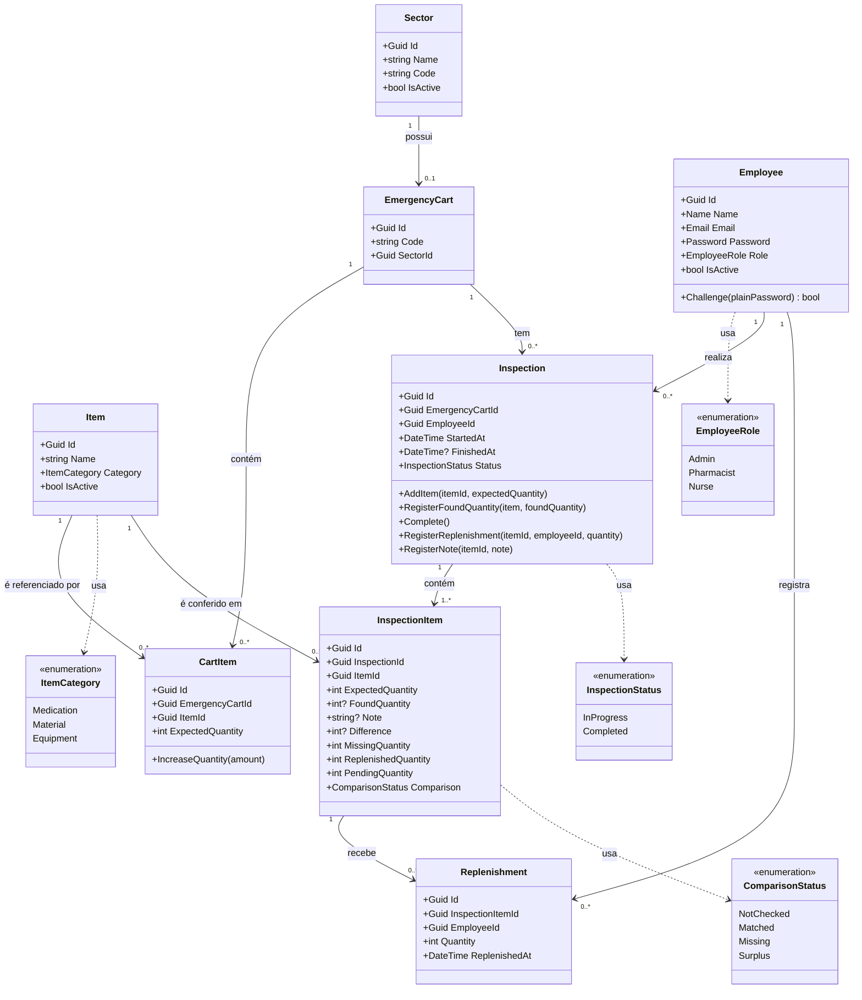

# 🚑 EmergencyCart

Sistema de gestão de carrinhos de emergência hospitalares controla quais itens (medicações, materiais e equipamentos) cada carrinho deve conter, em qual quantidade, e por quem essa informação pode ser definida ou conferida.

Projeto acadêmico desenvolvido com arquitetura em camadas (Clean Architecture) e CQRS.

---

## 📋 Índice

- [Sobre o projeto](#-sobre-o-projeto)
- [Funcionalidades](#-funcionalidades)
- [Regras de negócio](#-regras-de-negócio)
- [Arquitetura](#-arquitetura)
- [Diagrama de classes](#-diagrama-de-classes)
- [Papéis e permissões](#-papéis-e-permissões)
- [Tecnologias](#-tecnologias)
- [Como rodar](#-como-rodar)
  - [Via Docker](#via-docker-recomendado)
  - [Localmente (Visual Studio)](#localmente-visual-studio)
- [Principais endpoints](#-principais-endpoints)
- [Roadmap](#-roadmap)

---

## 📖 Sobre o projeto

Em um hospital, cada carrinho de emergência precisa ter uma quantidade mínima de itens críticos (ex: 5 ampolas de adrenalina, 5 cânulas endotraqueais) sempre disponível. Conferir isso manualmente, com planilha ou papel, é lento e sujeito a erro humano - o que, num contexto de emergência, pode custar tempo precioso.

O EmergencyCart digitaliza esse processo:

- Cada **setor** do hospital (UTI, Centro Cirúrgico, etc.) tem seu próprio carrinho.
- Um **farmacêutico** define quais itens o carrinho deve conter e em qual quantidade (1 a 5 unidades por item).
- Um **farmacêutico ou enfermeiro** realiza a **conferência** do carrinho: registra a quantidade encontrada de cada item, e o sistema compara com a esperada e mostra o que está faltando.
- Os itens em falta viram **pendências**. Quem repõe registra a **reposição**, e pode deixar uma **observação** explicando a falta (ex.: reposição prevista para dezembro).
- Um **administrador (TI)** cuida do cadastro base do sistema de setores, itens e funcionários.

## 🧩 Funcionalidades

**Conferência do carrinho (AC2)**
1. O funcionário escolhe o setor e o carrinho e **inicia** a conferência. O sistema copia a quantidade esperada de cada item naquele momento.
2. Para cada item, informa a **quantidade encontrada** (pode corrigir enquanto a conferência estiver aberta).
3. A **comparação** mostra, item a item, se confere, está faltando, sobra ou ainda não foi conferido, e quanto falta.
4. Ao **finalizar**, a conferência fica registrada com a data. Se a página for recarregada no meio, a conferência em andamento pode ser **retomada** por quem a iniciou.

**Situação do carrinho (AC3)** - botão *Ver situação* em cada carrinho: mostra o resultado da última conferência finalizada, com esperado, encontrado, quanto falta, o que já foi reposto e as observações.

**Tela de pendências (AC3)** - lista, por carrinho, os itens em falta na última conferência finalizada, já descontando o que foi reposto.

**Reposição de itens (AC3)** - botão *Repor* em cada pendência: registra quantas unidades foram repostas, por quem e quando. A pendência diminui e some quando zera.

**Observação da falta (AC3)** - botão *Adicionar/Editar observação* em cada pendência: permite anotar o motivo da falta (até 200 caracteres). A observação aparece na tela de pendências e na situação do carrinho.

**Onde cada funcionalidade aparece (front → back → banco de dados):**

| Funcionalidade | Front-end | Back-end | Banco de dados |
|---|---|---|---|
| Conferência do carrinho | Tela *Conferência* | `POST /api/inspection/{emergencyCartId}`, `PATCH .../items/{itemId}`, `PATCH .../complete`, `GET .../comparison`, `GET .../in-progress/{emergencyCartId}` | Tabelas `Inspection` e `InspectionItem` |
| Situação do carrinho | Botão *Ver situação* e tela de situação | `GET /api/inspection/last/{emergencyCartId}` + `GET .../comparison` | Leitura da última conferência finalizada |
| Tela de pendências | Tela *Pendências* | `GET /api/inspection/pending` | Consulta da última conferência finalizada de cada carrinho |
| Reposição de itens | Botão *Repor* | `POST .../items/{itemId}/replenishments` | **Nova tabela** `Replenishment` (item, funcionário, quantidade, data) |
| Observação da falta | Botão *Observação* | `PUT .../items/{itemId}/note` | **Nova coluna** `InspectionItem.Note` |

## 📏 Regras de negócio

- Um carrinho só pode ter **uma conferência em andamento** por vez (checado no código e garantido por índice único no banco).
- Só um carrinho **ativo e com itens configurados** pode ser conferido.
- A quantidade encontrada vai de **0 a 5** por item. "Não conferido" e "0" são coisas diferentes: 0 significa que o item foi conferido e não existe nenhum.
- Só **quem iniciou** a conferência registra as quantidades, finaliza e retoma. Para finalizar, **todos os itens** precisam ter quantidade registrada.
- **Pendência** é a quantidade em falta de um item na **última conferência finalizada** do carrinho, menos o que já foi reposto. Uma conferência nova substitui a anterior.
- **Reposição:** só sobre a última conferência finalizada do carrinho, em item com falta, de 1 até a quantidade ainda pendente. Fica registrado quem repôs e quando.
- **Observação:** só em item com falta da última conferência finalizada, com até 200 caracteres. Salvar texto vazio apaga a observação.

## 🏛 Arquitetura

O backend segue **Clean Architecture** com **CQRS** (via MediatR), separado em 4 projetos:

```
src/
├── EmergencyCart.Domain          → Entidades, Value Objects, regras de negócio
├── EmergencyCart.Application     → Commands, Queries, Handlers, Validators
├── EmergencyCart.Infrastructure  → EF Core, repositórios, segurança (JWT, hash de senha)
└── EmergencyCart.API             → Controllers, configuração da aplicação
```

**Por que essa separação:** o `Domain` não depende de nada externo (nem de banco, nem de framework web) - as regras de negócio (ex: "quantidade esperada entre 1 e 5", "código do carrinho é único") vivem isoladas e são testáveis sem precisar de banco de dados real. `Application` orquestra os casos de uso. `Infrastructure` é a única camada que sabe que existe SQL Server. `API` só expõe isso via HTTP.

O front-end (em `src/EmergencyCart.Web`) é uma SPA simples em **HTML/CSS/JS puro** (sem framework), consumindo a API via `fetch`.

## 🗺 Diagrama de classes



## 🔐 Papéis e permissões

Autenticação via **JWT**, com autorização por papel (`[Authorize(Roles = "...")]`) em cada endpoint.

| Ação | Admin (TI) | Farmacêutico | Enfermeiro |
|---|:---:|:---:|:---:|
| Cadastrar setor | ✅ | ❌ | ❌ |
| Cadastrar item | ✅ | ❌ | ❌ |
| Cadastrar funcionário | ✅ | ❌ | ❌ |
| Criar carrinho de emergência | ❌ | ✅ | ❌ |
| Configurar quantidade esperada por item | ❌ | ✅ | ❌ |
| Realizar conferência do carrinho | ❌ | ✅ | ✅ |
| Consultar situação do carrinho e pendências | ❌ | ✅ | ✅ |
| Registrar reposição e observação da falta | ❌ | ✅ | ✅ |
| Consultar setores / itens / carrinhos | ✅ | ✅ | ✅ |

## 🛠 Tecnologias

**Backend:** .NET 9 · C# · Entity Framework Core · SQL Server · MediatR (CQRS) · FluentValidation · JWT (Microsoft.IdentityModel.Tokens) · BCrypt.Net (hash de senha)

**Frontend:** HTML5 · CSS3 · JavaScript (Vanilla, `fetch` API)

**Infraestrutura:** Docker · Docker Compose

## 🚀 Como rodar

### Via Docker (recomendado)

O `docker-compose.yml` sobe **somente a API**. O banco SQL Server **não** é criado pelo compose: a API conecta em um SQL Server que já esteja rodando na sua máquina (`host.docker.internal,1433`, banco `EmergencyCartDb`, login `emergencycart_api`).

**1. Tenha o banco pronto:** SQL Server acessível na porta 1433 com o login acima e as migrations aplicadas (veja o passo 3 de "Localmente").

**2. Copie o arquivo de variáveis de ambiente e preencha:**
```bash
cp .env.example .env
```
- `DB_PASSWORD`: senha do login `emergencycart_api`.
- `JWT_SIGNING_KEY`: chave de assinatura do JWT, com no mínimo 32 caracteres.

**3. Suba o container:**
```bash
docker compose up --build
```

**4. Acesse:**
- API: `http://localhost:7085` (documentação OpenAPI em `http://localhost:7085/openapi/v1.json`, só em ambiente de desenvolvimento).
- Front-end: abra `src/EmergencyCart.Web/index.html` (ex: via Live Server do VS Code, porta 5500, que é a liberada no CORS) e ajuste `API_BASE_URL` em `js/app.js` para `http://localhost:7085`.

**Login inicial (Admin):**
```
E-mail: admin@hospital.com
Senha: Admin123!
```

### Localmente (Visual Studio)

1. Configure a connection string do SQL Server local em `appsettings.Development.json` (ou via `dotnet user-secrets`).
2. Configure `Settings:Jwt:SigningKey` (mínimo 32 caracteres) via User Secrets.
3. Rode as migrations:
   ```bash
   dotnet ef database update --project src/EmergencyCart.Infrastructure --startup-project src/EmergencyCart.API
   ```
4. `F5` no Visual Studio, ou:
   ```bash
   dotnet run --project src/EmergencyCart.API
   ```
5. Ajuste `API_BASE_URL` em `src/EmergencyCart.Web/js/app.js` para `https://localhost:7085`.

## 📡 Principais endpoints

| Método | Rota | Papel exigido | Descrição |
|---|---|:---:|---|
| `POST` | `/api/login` | - | Autenticação, retorna JWT |
| `POST` | `/api/employee` | Admin | Cadastra funcionário |
| `GET` | `/api/employee` | Admin | Lista funcionários |
| `POST` | `/api/sector` | Admin | Cadastra setor |
| `GET` | `/api/sector` | Autenticado | Lista setores |
| `POST` | `/api/item` | Admin | Cadastra item |
| `GET` | `/api/item` | Autenticado | Lista itens |
| `POST` | `/api/emergencycart/{sectorCode}` | Farmacêutico | Cria carrinho para um setor |
| `GET` | `/api/emergencycart` | Autenticado | Lista carrinhos |
| `POST` | `/api/cartitem/{emergencyCartId}` | Farmacêutico | Associa item ao carrinho, com quantidade esperada |
| `PUT` | `/api/cartitem/{cartItemId}` | Farmacêutico | Ajusta quantidade esperada |
| `GET` | `/api/cartitem/{emergencyCartId}` | Autenticado | Lista itens configurados de um carrinho |
| `POST` | `/api/inspection/{emergencyCartId}` | Farmacêutico, Enfermeiro | Inicia a conferência de um carrinho (copia os itens esperados) |
| `GET` | `/api/inspection/in-progress/{emergencyCartId}` | Farmacêutico, Enfermeiro | Retoma a conferência em andamento (só quem a iniciou) |
| `GET` | `/api/inspection/{inspectionId}/comparison` | Farmacêutico, Enfermeiro | Esperado × encontrado por item (`?onlyMissing=true` traz só os faltantes) |
| `PATCH` | `/api/inspection/{inspectionId}/items/{itemId}` | Farmacêutico, Enfermeiro | Registra a quantidade encontrada de um item |
| `PATCH` | `/api/inspection/{inspectionId}/complete` | Farmacêutico, Enfermeiro | Finaliza a conferência |
| `GET` | `/api/inspection/last/{emergencyCartId}` | Farmacêutico, Enfermeiro | Última conferência finalizada do carrinho |
| `GET` | `/api/inspection/pending` | Farmacêutico, Enfermeiro | Pendências: itens em falta na última conferência de cada carrinho |
| `POST` | `/api/inspection/{inspectionId}/items/{itemId}/replenishments` | Farmacêutico, Enfermeiro | Registra a reposição de um item em falta |
| `PUT` | `/api/inspection/{inspectionId}/items/{itemId}/note` | Farmacêutico, Enfermeiro | Registra ou apaga a observação da falta |

## 🧭 Roadmap

- [x] **AC1** - Setores, itens, carrinhos, configuração de itens esperados, autenticação e permissões
- [x] **AC2** - Conferência do carrinho (iniciar, registrar a quantidade encontrada, comparar esperado × encontrado, identificar faltantes, finalizar e retomar uma conferência em andamento)
- [x] **AC3** - Tela de pendências e reposição de itens, mais a situação do carrinho e a observação da falta
- [ ] **AC4** - Histórico de uso e indicadores

> O Dashboard ainda exibe números de exemplo (exceto o total de carrinhos e de setores). Os indicadores reais entram na AC4.

---

<sub>Projeto acadêmico - não utilizado em ambiente hospitalar real.</sub>
