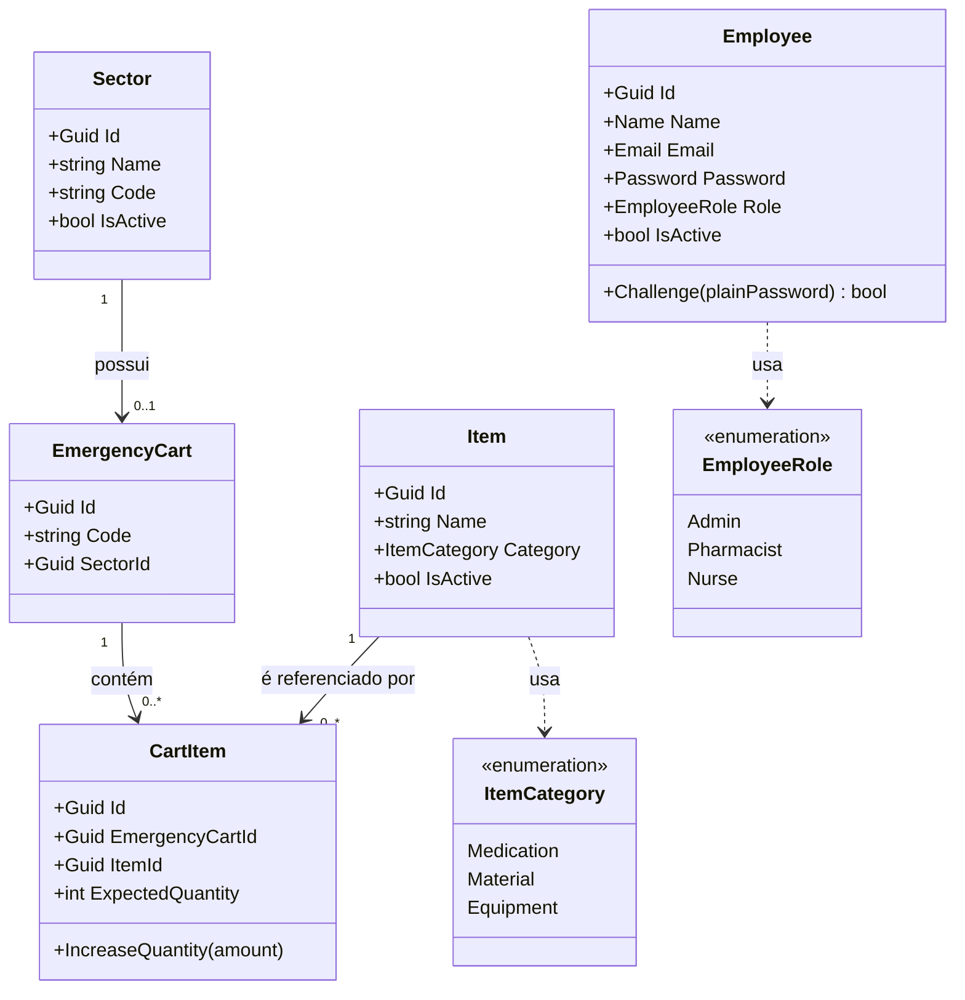

# 🚑 EmergencyCart

Sistema de gestão de carrinhos de emergência hospitalares controla quais itens (medicações, materiais e equipamentos) cada carrinho deve conter, em qual quantidade, e por quem essa informação pode ser definida ou conferida.

Projeto acadêmico desenvolvido com arquitetura em camadas (Clean Architecture) e CQRS.

---

## 📋 Índice

- [Sobre o projeto](#-sobre-o-projeto)
- [Arquitetura](#-arquitetura)
- [Diagrama de classes](#-diagrama-de-classes)
- [Papéis e permissões](#-papéis-e-permissões)
- [Tecnologias](#-tecnologias)
- [Como rodar](#-como-rodar)
  - [Via Docker](#via-docker-recomendado)
  - [Localmente (Visual Studio)](#localmente-visual-studio)
- [Principais endpoints](#-principais-endpoints)
- [Roadmap](#-roadmap)

---

## 📖 Sobre o projeto

Em um hospital, cada carrinho de emergência precisa ter uma quantidade mínima de itens críticos (ex: 5 ampolas de adrenalina, 5 cânulas endotraqueais) sempre disponível. Conferir isso manualmente, com planilha ou papel, é lento e sujeito a erro humano - o que, num contexto de emergência, pode custar tempo precioso.

O EmergencyCart digitaliza esse processo:

- Cada **setor** do hospital (UTI, Centro Cirúrgico, etc.) tem seu próprio carrinho.
- Um **farmacêutico** define quais itens o carrinho deve conter e em qual quantidade (1 a 5 unidades por item).
- Um **enfermeiro** confere periodicamente se a quantidade encontrada bate com a esperada.
- Um **administrador (TI)** cuida do cadastro base do sistema - setores, itens e funcionários.

## 🏛 Arquitetura

O backend segue **Clean Architecture** com **CQRS** (via MediatR), separado em 4 projetos:

```
src/
├── EmergencyCart.Domain          → Entidades, Value Objects, regras de negócio
├── EmergencyCart.Application     → Commands, Queries, Handlers, Validators
├── EmergencyCart.Infrastructure  → EF Core, repositórios, segurança (JWT, hash de senha)
└── EmergencyCart.API             → Controllers, configuração da aplicação
```

**Por que essa separação:** o `Domain` não depende de nada externo (nem de banco, nem de framework web) - as regras de negócio (ex: "quantidade esperada entre 1 e 5", "código do carrinho é único") vivem isoladas e são testáveis sem precisar de banco de dados real. `Application` orquestra os casos de uso. `Infrastructure` é a única camada que sabe que existe SQL Server. `API` só expõe isso via HTTP.

O front-end é uma SPA simples em **HTML/CSS/JS puro** (sem framework), consumindo a API via `fetch`.

## 🗺 Diagrama de classes



## 🔐 Papéis e permissões

Autenticação via **JWT**, com autorização por papel (`[Authorize(Roles = "...")]`) em cada endpoint.

| Ação | Admin (TI) | Farmacêutico | Enfermeiro |
|---|:---:|:---:|:---:|
| Cadastrar setor | ✅ | ❌ | ❌ |
| Cadastrar item | ✅ | ❌ | ❌ |
| Cadastrar funcionário | ✅ | ❌ | ❌ |
| Criar carrinho de emergência | ❌ | ✅ | ❌ |
| Configurar quantidade esperada por item | ❌ | ✅ | ❌ |
| Realizar conferência do carrinho | ❌ | ✅ | ✅ |
| Consultar setores / itens / carrinhos | ✅ | ✅ | ✅ |

## 🛠 Tecnologias

**Backend:** .NET 9 · C# · Entity Framework Core · SQL Server · MediatR (CQRS) · FluentValidation · JWT (Microsoft.IdentityModel.Tokens) · BCrypt.Net (hash de senha)

**Frontend:** HTML5 · CSS3 · JavaScript (Vanilla, `fetch` API)

**Infraestrutura:** Docker · Docker Compose

## 🚀 Como rodar

### Via Docker (recomendado)

Sobe a API e um banco SQL Server do zero, já com um usuário Administrador pré-cadastrado.

**1. Copie o arquivo de variáveis de ambiente:**
```bash
cp .env.example .env
```

**2. Suba os containers:**
```bash
docker compose up --build
```

**3. Acesse:**
- API/Swagger: `http://localhost:7085/swagger`
- Front-end: abra `index.html` (ex: via Live Server do VS Code)

**Login inicial (Admin):**
```
E-mail: admin@hospital.com
Senha: Admin123!
```

### Localmente (Visual Studio)

1. Configure a connection string do SQL Server local em `appsettings.Development.json` (ou via `dotnet user-secrets`).
2. Configure `Settings:Jwt:SigningKey` (mínimo 32 caracteres) via User Secrets.
3. Rode as migrations:
   ```bash
   dotnet ef database update --project src/EmergencyCart.Infrastructure --startup-project src/EmergencyCart.API
   ```
4. `F5` no Visual Studio, ou:
   ```bash
   dotnet run --project src/EmergencyCart.API
   ```
5. Ajuste `API_BASE_URL` no `app.js` do front para `https://localhost:7085`.

## 📡 Principais endpoints

| Método | Rota | Papel exigido | Descrição |
|---|---|:---:|---|
| `POST` | `/api/login` | - | Autenticação, retorna JWT |
| `POST` | `/api/employee` | Admin | Cadastra funcionário |
| `GET` | `/api/employee` | Admin | Lista funcionários |
| `POST` | `/api/sector` | Admin | Cadastra setor |
| `GET` | `/api/sector` | Autenticado | Lista setores |
| `POST` | `/api/item` | Admin | Cadastra item |
| `GET` | `/api/item` | Autenticado | Lista itens |
| `POST` | `/api/emergencycart/{sectorCode}` | Farmacêutico | Cria carrinho para um setor |
| `GET` | `/api/emergencycart` | Autenticado | Lista carrinhos |
| `POST` | `/api/cartitem/{emergencyCartId}` | Farmacêutico | Associa item ao carrinho, com quantidade esperada |
| `PUT` | `/api/cartitem/{cartItemId}` | Farmacêutico | Ajusta quantidade esperada |
| `GET` | `/api/cartitem/{emergencyCartId}` | Autenticado | Lista itens configurados de um carrinho |

## 🧭 Roadmap

- [x] **AC1** - Setores, itens, carrinhos, configuração de itens esperados, autenticação e permissões
- [ ] **AC2** - Conferência do carrinho (comparar quantidade esperada x encontrada, registro da conferência, identificação de faltantes)
- [ ] **AC3** - Tela de pendências e fluxo de reposição de itens
- [ ] **AC4** - Histórico de uso e indicadores

---

<sub>Projeto acadêmico - não utilizado em ambiente hospitalar real.</sub>
